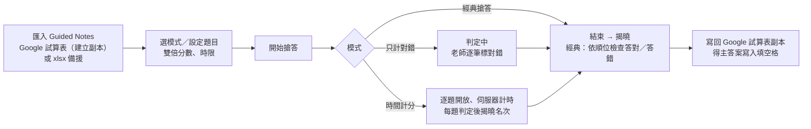
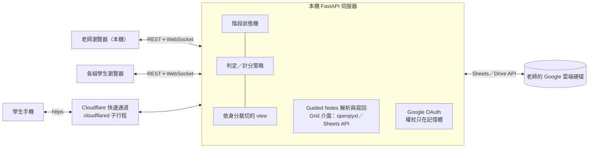

# 產品 TRD：Vibe Coding 課堂搶答系統

> 給第一次看這個專案的人：5 分鐘讀完就知道它做什麼、哪裡和一般搶答系統不同、要往哪裡看。
> 本檔在兩個 repo 逐位元組相同。細節以 `docs/requirements.md`（需求）、`contracts/api.md`（介面）、各組規格為準；本檔衝突時以它們為準。
> 知識時點：2026-11-26（第一～三期、Google 直連、題目敘述、答對／答錯檢查、antd 工作檯、手機 QR、啟動簡化皆已合入 `dev`）。

## 1. 一句話

**老師把填空式學習單（Guided Notes，Google 試算表）丟進來，各組線上搶答，伺服器公平判定誰最快，結束後一鍵把得主答案寫回原學習單的填空格。**

## 2. 解決什麼問題

| 以前（紙本＋黑板） | 現在 |
|---|---|
| 活動前發講義、活動中收回、學生輪流上台寫黑板 | 每組一台裝置線上作答，老師畫面即時看到全部 |
| 誰先舉手靠肉眼判斷，容易吵架 | **伺服器收到的順序**決定誰最快，不信任客戶端時間 |
| 講義收回後學生手上沒題目 | 搶答開始後學生畫面顯示每題（含題組子題）的題目敘述 |
| 抄黑板時別組看得到答案 | 搶答結束前，**任何一組都看不到別組的答案或是否已送出**（唯一例外：時間計分每題揭曉後公開各組名次，不含答案與分數） |
| 課後還要把答案謄回學習單 | 老師以 Google 帳號登入，系統直接讀寫雲端試算表：匯入時複製一份「<原標題>_作答情況」副本，結束後答案寫進副本的填空格，原試算表不動 |
| 最快的答案不一定對 | 結束後老師依順位逐題檢查：答錯換下一組、答對鎖定，得主與匯出跟著變 |

## 3. 使用者與流程

- **老師**：一人，在本機用老師頁操作；啟動後瀏覽器自動開老師頁（金鑰載入後自網址列移除），頂部「開始前的設定」清單引導完成 Google 設定精靈、手機連線與匯入。
- **學生**：以**組**為單位，預設 4 組（可設 2–50 組）；每組一台裝置（本機分頁，或手機掃老師頁的 QR code 經 Cloudflare 快速通道進入），裝置掛掉由老師「釋放」；老師開啟**組隊**時一組最多 6 台，第二台起憑該組邀請碼加入。

活動階段由伺服器統一推送到所有畫面：**準備中 → 搶答中 →（判定中）→ 已結束**。

## 4. 功能一覽

| 功能 | 說明 | 需求 | 狀態 |
|---|---|---|---|
| 匯入 Guided Notes | 老師以 Google 帳號登入後貼試算表連結：複製一份「_作答情況」副本並以 Sheets API 讀取；或上傳 xlsx（≤5 MB，備援）；依**表頭文字**與**合併儲存格**自動找題號欄、作答欄、題目欄與題組 | R-02、X-01 | 已合入 |
| 題目敘述 | 匯入可選的題目欄（題目／題目敘述／問題…），逐子題讀取；學生只在搶答開始後看到（逐題模式只看已開放題） | X-04 | 已合入（`question-text`） |
| 經典搶答 | 全部題目同時開放；每組每題送出一次、不可改；題組一次送出全部子題；最先送出者得分 | R-03、R-06、R-07、R-10 | 已合入 |
| 答對／答錯檢查 | 經典搶答結束後老師依順位逐題檢查：答錯換下一組、答對鎖定，全部答錯該題無得主；得主、得分、學生結果與匯出一致 | R-05、X-03、X-04 | 已合入（`answer-review`） |
| 即時結果與揭曉 | 老師隨時看「題號 × 組別」表；學生在結束後才看到得主、全部答案與順位 | R-04、R-08、R-09 | 已合入 |
| 寫回 Guided Notes | 得主答案以 Sheets API 寫入副本中匯入時記下的作答格（題組子題寫在標籤右側的填空格），原試算表不動；另可下載「<原檔名>_作答情況.xlsx」備援 | R-05 | 已合入 |
| 只計對錯模式 | 不比速度、比正確；結束後老師判定，參考答案欄可預填建議並「採用全部建議」 | X-04 | 已合入 |
| 雙倍分數題 | 任何模式下把指定題目設為 ×2 分，學生看得到標記 | X-04 | 已合入 |
| 時間計分模式（Kahoot 式） | 老師逐題開放、每題 5–120 秒時限由伺服器計時；答越快分越高（最高 1000 分 × 倍率）；每題揭曉後公開各組**名次** | X-04 | 已合入 |
| 組隊 | 活動設定，可與任一模式搭配：一組最多 6 台裝置、憑邀請碼加入，組內任一人送出即代表全組，搶答中組員看得到本組草稿（老師與他組看不到） | X-04 | 已合入 |
| 手機掃 QR code | 老師頁一鍵「開啟手機連線」（Cloudflare 快速通道），QR code 換成公開網址；老師身分只在本機，公開網址打老師端點一律拒絕 | R-01、X-04 | 已合入（`student-qr`、`easy-setup`） |
| 工作檯介面 | antd 版型：玻璃頂欄、左側導覽、內容卡；學生頁手機可用 | R-01、R-04 | 已合入（`web-workbench`） |
| 啟動即用 | 啟動自動開老師頁、Google 設定精靈（免手編 `.env`、免重啟）、開始前的設定清單、`start.cmd` 缺工具時代裝；老師金鑰不留在網址列 | R-01、X-04 | 已合入（`easy-setup`、`teacher-key-hidden`） |
| CSV 匯出、公平順位 | 見 `docs/parity.md` §4（錯誤遞補已由「答對／答錯檢查」取代） | X-02、X-03 | 未開 |

## 5. 專案特色（和一般搶答系統不一樣的地方）

1. **公平判定以伺服器為準**：順位只看伺服器事件迴圈的接收序號，同題並發恰一組成功；時間計分的作答秒數也是伺服器單調時鐘量的，學生改電腦時間沒有用。
2. **作答隔離是 fail-closed**：每條送往學生端的資料都先依「身分 × 階段」裁切，認不出就給最少資訊；每條學生端通道都有「A 組 payload 不含 B 組答案」的負例測試。時間計分的排行榜只給名次不給他組分數，因為分數相減就能反推他組作答秒數。
3. **不寫死任何儲存格座標**：課程規定助教會換一份版面不同的學習單測試，所以匯入靠表頭別名（題號／編號／No、作答／答案／Answer…）與合併範圍定位，至少三份版面不同的夾具測試全綠。
4. **直接讀寫雲端 Google 試算表，原檔不動**：老師以 OAuth 登入（PKCE、`state` 以 cookie 綁定瀏覽器），權杖只在伺服器記憶體；匯入時先複製一份副本，解析與寫回都對同一份副本，匯入後原檔被改也不會讓答案錯位。
5. **一套題目、多種玩法**：題目集與模式分離，計分規則是可替換的策略物件；加新模式不必改匯入匯出（`docs/trd-game-modes.md`）。
6. **兩個 repo、兩套開發方法、同一個產品**：OpenSpec 組（proposal → design → specs → tasks）與 SpecKit 組（constitution → spec＋PlantUML 圖 → plan → tasks），程式碼逐字相同，共用文件由 `make gate-parity` 逐位元組比對。
7. **第一次使用不用碰終端機**：啟動自動開老師頁，Google OAuth 用戶端在老師頁精靈貼上即生效（伺服器以白名單驗證後只改 `.env` 兩鍵），手機連線一鍵開關——助教換一份 Guided Notes、換一個 Google 帳號也能自己跑起來。
8. **AI 代理開發，但有紀律**：變更分 S／B／C 三檔決定評審深度；核心口徑（判定、隔離、狀態機、寫回）的卡走紅隊＋架構雙通道評審；門禁腳本都附「錯時會紅」的變異實錄；人工驗證見 `docs/manual-verification.md`。

## 6. 架構

| 層 | 選型 |
|---|---|
| 後端 | Python 3.12、FastAPI、WebSocket（`server/quiz_server/`） |
| 前端 | React＋Vite＋TypeScript＋antd 5，老師端與學生端同一套元件（`web/src/`） |
| 試算表 | Google Sheets API v4＋Drive API v3（httpx 直接呼叫）；xlsx 備援用 openpyxl |
| 儲存 | 伺服器記憶體（重啟即清空，結束後請先匯出）；Google 用戶端設定存 repo 根目錄 `.env`（不入庫） |
| 手機連線 | Cloudflare 快速通道（cloudflared，選用；每次網址不同） |

伺服器只在本機執行，不架設對外伺服器（需求 §1）；要讓手機連線時由老師在老師頁開啟快速通道，老師端點仍只接受本機請求。

## 7. 不做什麼

遊戲幣與道具、學生自己翻題的自主步調、跨活動的累積排行榜、資料庫與持久化、固定網域（快速通道每次網址不同）、服務帳號與多位老師同時登入。

## 8. 從哪裡開始看

| 想知道 | 看 |
|---|---|
| 怎麼跑起來 | `README.md`「開始使用」 |
| 怎麼錄 Demo 影片 | `docs/demo-recording.md` |
| 需求原文與評分重點 | `docs/requirements.md` |
| 兩組功能清單與狀態 | `docs/parity.md` §4 |
| 遊戲模式的技術需求 | `docs/trd-game-modes.md` |
| API 與 WebSocket 介面 | `contracts/api.md` |
| 行為規格 | OpenSpec 組 `openspec/specs/`；SpecKit 組 `specs/`＋`diagrams/` |
| 開發流程與 AI 代理規範 | `docs/workflow.md`、`CLAUDE.md` |
| 人工驗證怎麼做 | `docs/manual-verification.md` |

